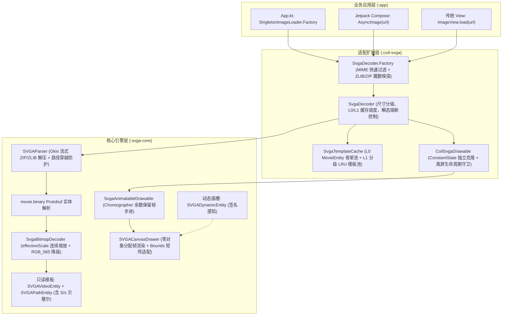

# Coil-SVGA 高性能动效 SDK 技术方案与深度架构设计

> 快速接入指南与 API 速查请参阅项目根目录 [`README.md`](file:///Users/niwaxx/AndroidStudioProjects/SvgaCoil/README.md)。本文档聚焦于底层架构设计、内存治理模型、渲染管线优化及核心技术决策。

---

## 1. 方案背景与核心目标

### 1.1 现状与痛点
1. **OOM 频发与显存失控**：官方 `SVGAPlayer-Android` 将 SVGA 内的所有 PNG 切片素材全量、全尺寸解码为 `ARGB_8888` 格式。一个小尺寸挂件/头像框（如 60dp）加载 1080p 设计稿切片时，单次解码可吞噬 30MB~80MB 内存，多实例或列表快速滑动时极易打爆堆内存并引发 OOM。
2. **动静割裂与开发体验差**：业务层需要硬编码区分静态图与 SVGA（`ImageView` vs `SVGAImageView`），代码分支繁琐。
3. **Jetpack Compose 适配生硬**：官方库依赖传统 View，通过 `AndroidView` 嵌套会导致状态重组卡顿、生命周期脱节与闪烁。
4. **底层库维护停滞**：YY 官方库多年未维护，存在高刷屏帧率失准、Protobuf 依赖老旧、缺乏大图熔断与内存泄漏等历史包袱。

### 1.2 核心设计目标
* **内存压降 60%~85%**：基于目标控件展示尺寸实现内部素材**连续比例动态降采样（Downsampling）**与 `RGB_565` 像素格式降级，阻断 OOM。
* **动静统一 API**：业务端无感使用 `AsyncImage(model = url)` 或 `ImageView.load(url)`，抹平静态图与动效格式差异。
* **L0 + L1 享元二级缓存与向下兼容复用**：底层 `MovieEntity` 动画骨架（L0）与按分辨率分级的 `SVGAVideoEntity` 位图模板（L1）共享只读；上层 `SVGADynamicEntity` 运行时轻量组装，互不污染。
* **大礼物熔断隔离与安全回收**：超阈值大动效自动走瞬态通道（Ephemeral），不污染 L1 缓存，并在动画结束时安全释放位图引用而不触发 `RenderThread` 崩溃。
* **双层解耦架构**：核心引擎 `:svga-core` 与适配层 `:coil-svga` 物理隔离，保证 Coil 版本升级零侵入。

---

## 2. 总体架构设计

SDK 采用严格的**关注点分离与双层适配架构**：



### 2.1 模块职责划分

| 模块名 | 定位 | 外部依赖 | 核心职责 |
| :--- | :--- | :--- | :--- |
| **[`:svga-core`](file:///Users/niwaxx/AndroidStudioProjects/SvgaCoil/svga-core)** | 纯动效底层引擎 | Android SDK, Okio, Protobuf-javalite | 负责 ZIP/ZLIB 内存流式解压、Protobuf 实体解析、位图连续缩放下采样、零分配 Canvas 帧渲染器、自驱动 `Animatable2Compat` Drawable 状态机。**不依赖任何图片加载库**。 |
| **[`:coil-svga`](file:///Users/niwaxx/AndroidStudioProjects/SvgaCoil/coil-svga)** | Coil 3 适配扩展 | `:svga-core`, `io.coil-kt.coil3:coil` | 实现 Coil 3 `Decoder` / `Decoder.Factory`，管理 L0/L1 享元缓存与向下兼容复用，处理 `ConstantState` 多视图隔离与 DSL 扩展。 |

---

## 3. 关键技术攻坚与实现细节

### 3.1 防 OOM 核心机制：连续比例下采样（[`SvgaBitmapDecoder.kt`](file:///Users/niwaxx/AndroidStudioProjects/SvgaCoil/svga-core/src/main/java/com/opensource/svga/core/bitmap/SvgaBitmapDecoder.kt)）

在真实业务中，设计师常将 $1000 \times 1000$ 的高清切片放进 $500 \times 500$ 的画布并通过 `Transform` 矩阵缩小显示。若仅比较切片尺寸与画布尺寸，或将两者割裂计算，会导致降采样失效或过度模糊。

本方案采用 **连续有效缩放比模型（`effectiveScale`）**：

```kotlin
val canvasScale = if (videoWidth > 0 && videoHeight > 0 && reqWidth > 0 && reqHeight > 0) {
    maxOf(reqWidth.toFloat() / videoWidth.toFloat(), reqHeight.toFloat() / videoHeight.toFloat())
} else 1f

val targetScale = if (reqWidth > 0 && reqHeight > 0) {
    maxOf(reqWidth.toFloat() / rawWidth.toFloat(), reqHeight.toFloat() / rawHeight.toFloat())
} else 1f

val validCanvasScale = if (canvasScale > 0f && canvasScale < 1f) canvasScale else 1f
val validTargetScale = if (targetScale > 0f && targetScale < 1f) targetScale else 1f
val effectiveScale = minOf(validCanvasScale, validTargetScale)
```

* **显存收益**：
  * **2 的幂次采样率**：基于 `effectiveScale` 计算目标像素宽高并求解最大 2 的幂次 `inSampleSize`，小尺寸容器下显存直降为原有的 $1/16 \sim 1/64$。
  * **色彩配置自动降级**：在 `inJustDecodeBounds` 探测阶段同时识别 `outMimeType` 与 Alpha 通道，不透明图像自动采用 `Bitmap.Config.RGB_565` 解码，单张位图内存再降 50%。

### 3.2 L0 + L1 享元二级缓存与向下兼容复用（[`SvgaTemplateCache.kt`](file:///Users/niwaxx/AndroidStudioProjects/SvgaCoil/coil-svga/src/main/java/com/opensource/svga/coil/SvgaTemplateCache.kt)）

为了解决同一 SVGA 在不同尺寸容器（如 40dp 挂件、120dp 卡片、260dp 弹窗）同时展示时的重复解码问题，设计了 **分辨率三档分级（Tier）+ 向下兼容查找机制**：

| 分辨率档位 (`SvgaResolutionTier`) | 容器尺寸范围 | 采样策略 | 向下兼容规则 |
| :--- | :--- | :--- | :--- |
| **`THUMBNAIL`** (`level = 1`) | $\le 96\text{px}$ | 深度下采样 | 可直接复用已缓存的 `THUMBNAIL`、`MEDIUM` 或 `FULL` 模板 |
| **`MEDIUM`** (`level = 2`) | $97\text{px} \sim 240\text{px}$ | 适度下采样 | 可直接复用已缓存的 `MEDIUM` 或 `FULL` 模板 |
| **`FULL`** (`level = 3`) | $> 240\text{px}$ | 1:1 高清母版 | 仅复用 `FULL` 模板，同时充当所有小尺寸容器的高清母版 |

* **L0 几何骨架共享**：若先加载了 `THUMBNAIL` 后加载 `FULL`，解码 `FULL` 位图时直接从 L0 缓存池读取已解析的 `MovieEntity` 骨架，跳过二次 ZLIB 解压与 Protobuf 反序列化。
* **熔断隔离与安全回收**：
  * 当单体显存超过 `maxCacheableBytes`（或配置 `maxCacheableBytes <= 0L`）时，拒绝写入 L1 缓存并标记 `isEphemeral = true`。
  * `autoRecycleOnEnd` 仅在 `isEphemeral == true` 时清空位图引用，且通过移除 `imageMap` 引用交由 GC 回收（默认不调用危险的 `Bitmap.recycle()`），彻底杜绝共享模板被掏空或 `RenderThread` 崩溃。

### 3.3 魔数嗅探与静态图零损耗放行（[`SvgaDecoder.kt`](file:///Users/niwaxx/AndroidStudioProjects/SvgaCoil/coil-svga/src/main/java/com/opensource/svga/coil/SvgaDecoder.kt)）

`SvgaDecoder.Factory.isApplicable` 按以下三步执行精准拦截：
1. **显式图片 MIME 快速放行**：若 `mimeType` 为 `image/png`、`image/jpeg`、`image/webp`、`image/gif`、`image/heif` 等标准静态图片类型，立即返回 `false`。
2. **静态图魔数黑名单过滤**：预读前 12 字节，快速排除 PNG (`89 50 4E 47`)、JPEG (`FF D8 FF`)、GIF (`47 49 46`) 及 RIFF/WebP (`52 49 46 46`)。
3. **ZIP 与 RFC1950 ZLIB 双重校验**：
   - 匹配 SVGA 1.x ZIP 头 (`50 4B 03 04`)；
   - 或匹配 SVGA 2.x ZLIB 头：要求 `CMF == 0x78`（Deflate + 32K 窗口）、`FDICT == 0` 且满足 RFC1950 校验和公式 $((b_0 \ll 8) + b_1) \bmod 31 == 0$，彻底消除随机二进制流误判。

### 3.4 VSYNC 余数保留帧步进与零分配渲染（[`SvgaAnimatableDrawable.kt`](file:///Users/niwaxx/AndroidStudioProjects/SvgaCoil/svga-core/src/main/java/com/opensource/svga/core/drawable/SvgaAnimatableDrawable.kt) & [`SVGACanvasDrawer.kt`](file:///Users/niwaxx/AndroidStudioProjects/SvgaCoil/svga-core/src/main/java/com/opensource/svga/core/drawer/SVGACanvasDrawer.kt)）

1. **余数保留帧推进算法（[`stepFrames`](file:///Users/niwaxx/AndroidStudioProjects/SvgaCoil/svga-core/src/main/java/com/opensource/svga/core/drawable/SvgaAnimatableDrawable.kt#L92-L120)）**：
   - 推进帧数时使用 `lastFrameTimeNanos += advanceFrames * frameIntervalNanos` 保留时间余数，而非简单覆盖为当前 `frameTimeNanos`，消除非整除刷新率（如 60Hz 屏幕播放 24fps 动效）下的累积时钟漂移；同时限制单次最大跳帧数 `MAX_FRAME_SKIP = 5`，防止主线程偶发卡顿时动画瞬间闪现到底。
2. **渲染热路径零对象分配（Zero-Allocation per Frame）**：
   - `SVGACanvasDrawer` 内部预分配复用 `Paint`、`Matrix`、`Path`、`RectF`、`FloatArray(9)` 以及动态插槽匹配列表 `matchedKeys`，在 60fps 连续渲染期间不产生任何短生命周期临时对象，规避 GC 抖动。
3. **跨容器 `Bounds` 与矩阵统一适配**：
   - `drawFrame` 优先基于 `Drawable.bounds` 宽高与偏移量计算 `SvgaScaleInfo`，使传统 `ImageView` 的 `mDrawMatrix`（`FIT_CENTER` / `CENTER_CROP` / `FIT_XY`）、`CrossfadeDrawable` 过渡动画与 Compose `DrawablePainter` 均能获得精确的几何缩放，避免双重缩放。
4. **矢量路径完整性（[`SVGAPathEntity.kt`](file:///Users/niwaxx/AndroidStudioProjects/SvgaCoil/svga-core/src/main/java/com/opensource/svga/core/model/SVGAPathEntity.kt)）**：
   - 使用有状态游标 `PathCursor` 跨指令段维护当前坐标与上一控制点，完整支持相对路径指令（`m`/`l`/`h`/`v`/`c`/`q`/`z`）以及平滑三次贝塞尔指令（`S`/`s`）的镜像控制点反射计算。

---

## 4. 里程碑执行状态

### 里程碑 1：核心解析引擎与 Okio 流式解耦 (`:svga-core`)
- [x] **Task 1.1**：构建独立模块 `:svga-core`，配置 `protobuf-javalite` 与 `okio` 依赖及消费端混淆规则。
- [x] **Task 1.2**：实现基于 Okio 的 ZIP / ZLIB 内存流式解压器，内置 Zip Slip 路径穿越防护与单条目体积上限校验。
- [x] **Task 1.3**：完成 `movie.binary` Protobuf 实体映射与 `SVGAPathEntity` 全指令集解析（含相对坐标游标与 `S`/`s` 平滑三次贝塞尔曲线）。

### 里程碑 2：防 OOM 动态降采样与自驱动渲染器
- [x] **Task 2.1**：实现 `SvgaBitmapDecoder` 连续缩放比 `effectiveScale` 计算与 `RGB_565` 自动降级。
- [x] **Task 2.2**：实现 `SvgaAnimatableDrawable`，基于 `Choreographer` 余数保留算法推进帧，支持 `alpha`/`colorFilter` 与 `ConstantState` 独立克隆。
- [x] **Task 2.3**：实现 `SVGACanvasDrawer` 零分配帧渲染与 `SVGADynamicEntity` 运行时插槽注入。

### 里程碑 3：Coil 3 适配层与二级缓存闭环 (`:coil-svga`)
- [x] **Task 3.1**：构建独立模块 `:coil-svga`，暴露 `io.coil-kt.coil3:coil` 标准接口。
- [x] **Task 3.2**：实现 `SvgaDecoder` 及其 `Factory`，支持 RFC1950 ZLIB / ZIP 魔数校验与多数据源缓存 Key 解析（Asset / Resource / Content URI）。
- [x] **Task 3.3**：实现 `SvgaTemplateCache`（L0 `MovieEntity` 骨架池 + L1 分辨率分级缓存 + 向下兼容复用 + 超大动效熔断隔离）。
- [x] **Task 3.4**：提供 `svgaDynamic`（基于 `memoryCacheKeyExtra` 无反射签名注入）、`svgaRepeatCount`、`svgaEphemeral` 与 `ImageView.findSvgaDrawable()` 扩展函数。

### 里程碑 4 & 5：全场景示例工程、单元测试与体积优化
- [x] **Task 4.1**：新增 [`App.kt`](file:///Users/niwaxx/AndroidStudioProjects/SvgaCoil/app/src/main/java/com/example/svgacoil/App.kt) 实现 `SingletonImageLoader.Factory` 规范化全局初始化与低内存自动清理。
- [x] **Task 4.2**：模块化重构 [`MainActivity.kt`](file:///Users/niwaxx/AndroidStudioProjects/SvgaCoil/app/src/main/java/com/example/svgacoil/MainActivity.kt) 与 `ui/demos/*`，提供全部 Compose `@Preview` 预览函数，并新增纯原生 View 专场测试页 [`LegacyViewDemoActivity.kt`](file:///Users/niwaxx/AndroidStudioProjects/SvgaCoil/app/src/main/java/com/example/svgacoil/LegacyViewDemoActivity.kt)。
- [x] **Task 5.1**：完成 `:svga-core` 与 `:coil-svga` 核心单元自动化测试集（[`SvgaMilestone2Test.kt`](file:///Users/niwaxx/AndroidStudioProjects/SvgaCoil/svga-core/src/test/java/com/opensource/svga/core/SvgaMilestone2Test.kt)、[`SvgaDecoderTest.kt`](file:///Users/niwaxx/AndroidStudioProjects/SvgaCoil/coil-svga/src/test/java/com/opensource/svga/coil/SvgaDecoderTest.kt)）。
- [x] **Task 5.2**：清理 `app/src/main/assets` 冗余测试资产，将资源目录体积从 **1.3 GB** 压缩至 **50 MB**（缩减 **96.2%**），完成 [`README.md`](file:///Users/niwaxx/AndroidStudioProjects/SvgaCoil/README.md) 与技术方案文档体系建设。
